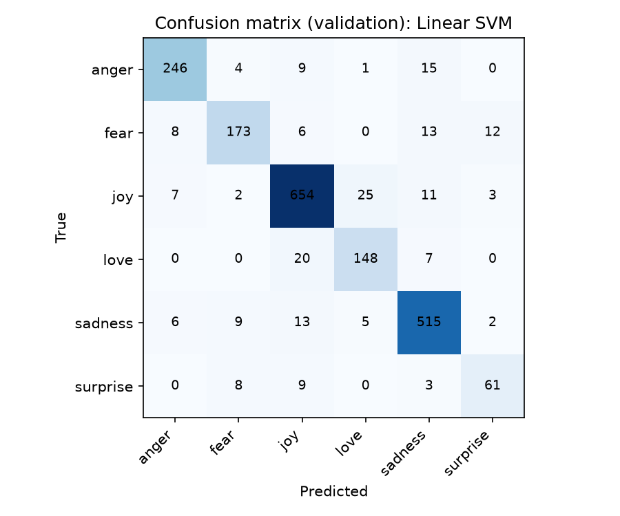

# Lumen: an emotion-aware mental health companion

**Live demo:** TODO (direct `.hf.space` link) · demo data may reset when the app restarts

A web chatbot for students that detects the emotion and intensity of a message, replies with
supportive and relaxation-based responses, and tracks mood over time. Built with Python, Flask,
scikit-learn (TF-IDF) and SQLite.

> Lumen is a self-help tool, not a medical device or a substitute for professional care.

TODO: add two screenshots (chat page, mood dashboard)

## Features
- Emotion detection (6 classes) with confidence scores and a rule-based intensity score
- Crisis-safety layer that runs before the model and shows Indian helplines (Tele-MANAS 14416, KIRAN 1800-599-0019, 112)
- Short-term memory of earlier emotions within a session (labels only, never message text)
- Accounts with hashed passwords, a mood dashboard, and a "delete my data" button
- Tests (32), GitHub Actions CI and a Dockerfile

## How the model was built
Dataset: Kaggle "Emotions dataset for NLP" (CC BY-SA 4.0), 20,000 short texts labelled sadness, joy,
love, anger, fear or surprise. Duplicate texts and train/validation/test overlap were removed.

Five models on TF-IDF (word 1-2 grams) were compared on the validation set; the best was chosen by macro-F1
because the classes are imbalanced (joy 33%, surprise 4%).

| Model | Validation macro-F1 |
|---|---|
| Complement Naive Bayes | 0.847 |
| Logistic Regression (C=1) | 0.849 |
| Logistic Regression (C=5) | 0.862 |
| Logistic Regression (C=20) | 0.859 |
| **Calibrated Linear SVM** | **0.868** |

**Held-out test set (used once): accuracy 0.889, macro-F1 0.833.**
Weakest classes: surprise (F1 0.64) and love (0.77).

### Error analysis
TODO: write 3-4 sentences in your own words. Facts from the validation confusion matrix: joy and love are
confused most (25 + 20 cases), then fear and sadness (13 + 9), and surprise has the fewest examples.

## Safety and privacy
- High-risk phrases trigger a fixed crisis message with helplines; the model cannot override it.
- Known limits: keyword rules miss indirect phrasing ("everyone would be better off without me") and can
  false-alarm on negations ("I don't want to die, I'm just tired"). Safety errs towards false alarms.
- The database has no column for message text. Only emotion, intensity and risk level are saved.
- Passwords are hashed, forms use CSRF tokens, and users can only read their own data.

## Limitations
- The model has no "neutral" class, so a confidence threshold and a first-person check handle off-topic text.
- Cannot detect sarcasm or negation reliably. Trained on English tweets, not on clinical data.
- The hosted demo may lose accounts and history when it restarts.

## Run locally
    python -m venv venv && venv\Scripts\activate
    pip install -r requirements.txt
    python -m ml.train        # needs data/train.txt, val.txt, test.txt
    python app.py             # http://127.0.0.1:5000
    python -m pytest

## Project structure
    app.py, wsgi.py, db.py   Flask app, production entry point, SQLite
    core/                    safety.py, intensity.py, responses.py, engine.py
    ml/                      data.py, train.py, predict.py
    templates/, static/      Frontend (HTML, CSS, JavaScript)
    tests/                   pytest suite

## Credits
Dataset: "Emotions dataset for NLP" on Kaggle (CC BY-SA 4.0).